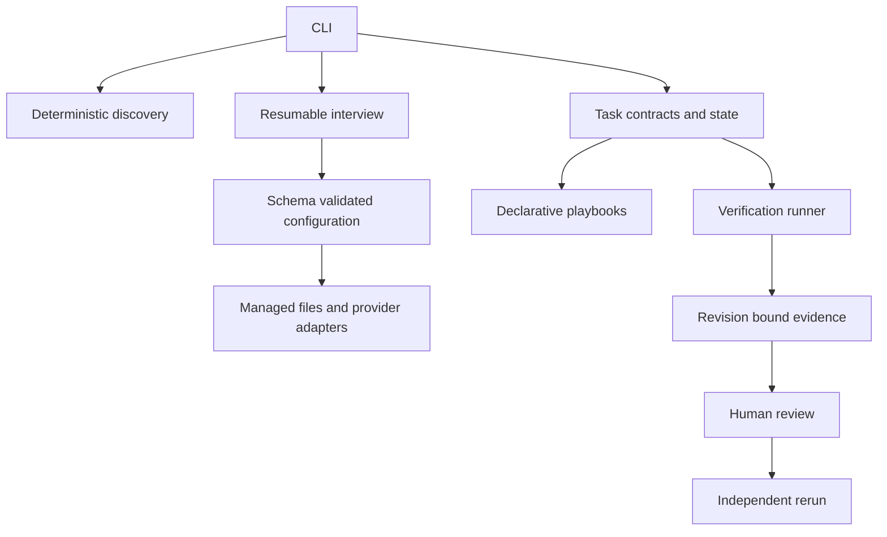

# Architecture

VERA uses a single distributable ES module package with a no-example distribution. JavaScript on a pinned Node baseline keeps installation free of compilation. JSON Schema validates the external configuration boundary. Modules isolate provider-specific instructions from the portable lifecycle.

Storage uses atomic file replacement and a workspace lock for cooperating CLI processes. Generated file manifests hash managed contents to detect conflicts. The source fingerprint includes file names and bytes outside standard build, dependency and VERA state directories. Checks that change this fingerprint produce UNKNOWN.

Eight playbooks cover features, debugging, refactoring, review, architecture, tests, regressions and integration. The portable orchestration handoff descriptor defines task identity, scope, dependencies, acceptance and evidence.

On `vera start`, VERA creates `.vera/ACTIVE_TASK.md` and a scoped task handoff. Provider adapters read the same project-neutral contract and only generate IDE integration; they do not invoke agents natively.\n\nTask progression starts at DRAFT and follows READY, IMPLEMENTING, VERIFYING and REVIEWING before DONE. Failures enter REPAIRING and eventually BLOCKED. Completion checks policy identity, source scope, dependencies, current evidence and approval of the verified source fingerprint.

## Roadmap

1. Add typed public SDK contracts and stronger persistent-state validation.
2. Add process-tree supervision on Windows and configurable isolated executors.
3. Add signed evidence from protected CI and externally owned gate definitions.
4. Add an interview UI with field-level correction and structured knowledge proposals.
5. Add isolated agent scheduling through the handoff interface, cancellation, cost limits and structured result collection.
6. Validate native provider automation only when documented APIs become available.

Parallel scheduling and isolated agent execution are optional future layers. For now, developers must choose an approved branch or workspace for their IDE agents; VERA does not automatically create an isolated checkout.
